

  

<h1 align="center">PHMN</h1>

<b>NOOP, reshaped around my own routine.</b>

A personal project, built for my own needs. Offline, on-device, no account, no cloud.

  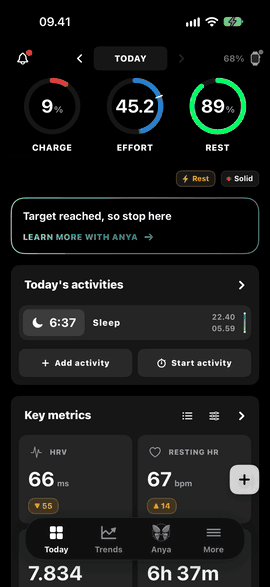
  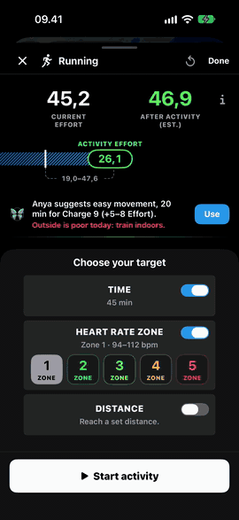
  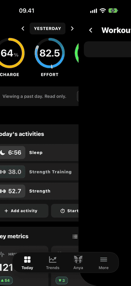
  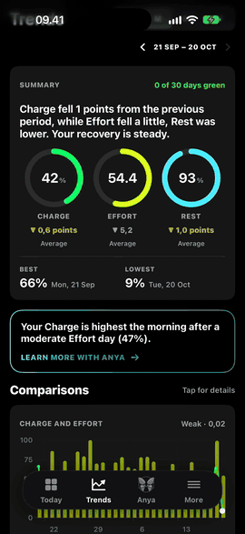

  <a href="#a-personal-project">About</a> ·
  <a href="#things-to-know-before-you-use-it">Before you use it</a> ·
  <a href="#the-tour">Feature tour</a> ·
  <a href="#how-the-numbers-are-made">Calculations</a> ·
  <a href="#install">Install</a> ·
  <a href="#build-from-source">Build</a> ·
  <a href="#credit-and-license">Credit</a>

---

## A personal project

PHMN is a fork of [NOOP](https://github.com/ryanbr/noop), the open-source app that reads a WHOOP strap over Bluetooth and keeps every number on your phone. I did not set out to
build a product. I use a WHOOP, I wanted the iPhone app to behave the way **I** check my day, and so I changed it until it did. Everything here follows my own habits and needs; it may
not fit yours, and I make no promise that it will.

The strap protocol, storage and base scores underneath are NOOP's. What I changed is what sits on top: a new design, a coach that reads your day, a Health tab, a workout module with a
Strength Trainer of its own, weekly plans, and the explanations behind every number. A few calculations differ too, and they are listed under [Things to know before you use it](#things-to-know-before-you-use-it).

**What stays true**

- Everything is computed and stored **on the phone**. There is no PHMN server, no account and no telemetry.
- Anything that can leave the phone (Strava, Apple Health, Hevy, weather and air, an AI provider) is **off until you turn it on**, uses **your own** key, and is listed under Privacy.
- Every figure is an **estimate, not medical advice**. Where a number needs history to mean anything, the app says what it is waiting for instead of inventing one.

---

## Things to know before you use it

A few things differ from NOOP on purpose. These are the ones that change what you see on screen, so please read them before you rely on the numbers.

- **Names.** The three scores are **Recovery**, **Strain** and **Sleep**, the words of WHOOP's app; NOOP calls them Charge, Effort and Rest. Strain is shown on WHOOP's 0 to 21 scale, and 0 to 100 is one switch away in Settings. The calculation notes keep the names the code uses.
- **Fitness age is a Body age.** Where NOOP estimates a fitness age from resting heart rate and activity, PHMN works out a weekly **Body age** from nine inputs, in the manner of WHOOP's Healthspan page: resting heart rate, VO₂ max,
  sleep duration, sleep regularity, steps, time in heart-rate zones 1 to 3 and 4 to 5, strength time and lean body mass. Each one shows the years it adds or takes away, and an input with no data says so instead of counting as zero. The **pace of aging**
  reads those weekly ages. The Vitality score is gone, because it was the same figure on another scale. The first time this version opens, up to 26 earlier weeks are worked out again with this model, since weeks stored by the older one are on another scale; there is nothing to do.
  The model is described in [docs/FITNESS_AGE.md](docs/FITNESS_AGE.md).
- **Strain.** On iOS the day's Strain is scored with Banister's exponential training impulse, which counts effort at every intensity (NOOP's zone-based score pays nothing below half of your heart-rate reserve) and subtracts the cost of simply being awake, calibrated against WHOOP's Day Strain on one wearer's days. Light and intermittent work shows, and a desk day nets about nothing. A switch under Advanced goes back to the zone-based score and re-scores your history.
- **Stress.** A 0 to 3 reading after WHOOP's public description of its Stress Monitor, from heart rate and heart-rate variability against your own baseline. It appears after 14 nights and replaces NOOP's formula in the app.
- **Steps.** On the WHOOP 5, today's step total is rebuilt from the strap's own step counter at launch and after every sync, so it no longer shows empty when an analysis finished before the counter data was complete. The step counting method itself is NOOP's.
- **Apple Health.** The sync to Apple Health sends steps in parts: only the new steps since the last write, so Apple Health never counts the same steps twice. For the step total shown on Home and in the widget, the strap's own count comes first, then Apple Health, then the on-device estimate.
- **Sleep.** I tested sleep for several nights on three devices (a Fitbit Air, a WHOOP 5 and a Garmin Forerunner 255) and the results varied quite a bit, so I changed three things in the sleep detection, aiming to land closer to the Fitbit Air. A short wake of up to three minutes in the middle of a night counts as light sleep when heart rate and movement still look like sleep. A night ends where the strap stopped recording, not where it kept running as "awake". And time the strap spent off the wrist is cut out of a night. Sleep performance, and the sleep part of Recovery, are built from how long and how well you slept, so both can shift for the same night. As before, you can edit the times of a night, and if you delete one you have 10 seconds to restore it with Undo.
- **Resting heart rate.** The number shown for resting heart rate is an average, not the lowest value as in NOOP. Recovery uses resting heart rate, and the baseline it is compared with is built from the same figure, so your Recovery can differ from NOOP's.
- **Workout detection.** The app offers a workout only when your heart rate reached the first zone for at least two minutes, and a suggestion you delete stays deleted, even when the next scan sees the same session a few minutes off. It only suggests and never saves on its own.
- **WHOOP 5.0 / MG alarm.** The strap's alarm is sent to a 5.0 / MG only while **WHOOP 5/MG wake alarm** is on under Experiments. A buzz at the set time is not confirmed on every 5.0 / MG, so keep a backup alarm. A WHOOP 4.0 needs no switch.
- **Strava.** If you decide to connect Strava, I suggest uploading manually at first. That lets you check exactly what is sent to Strava and decide whether you are comfortable with it.

---

## The tour

The animations are short screen recordings of the app on sample data.

- [Home](#home) · [Metrics](#metrics-recovery-strain-sleep-and-the-rest) · [Sleep](#sleep) · [Workouts](#workouts) · [Strength Trainer](#strength-trainer) · [Trends](#trends) · [Anya](#anya-the-coach)
- [Breathing](#breathing) · [Health](#health) · [Journal and plans](#journal-and-plans) · [Strap](#the-strap) · [Widgets and Live Activities](#widgets-live-activities-and-shortcuts)
- [Connections](#connections) · [Settings](#settings) · [Data and privacy](#data-and-privacy)

### Home

<table>
<tr>
<td valign="top">

The home screen is built to be read in a few seconds, then explored.

- **Three rings, pinned.** Recovery (how recovered you are), Strain (how much the day has taken) and Sleep (how well you slept). They shrink into a bar as you scroll. The Strain ring shows
  **today's target range**, worked out from your Recovery, as a grey stretch with a white mark where it starts.
- **At the top**, your avatar and day streak at the left, the day and a calendar to pick another one in the middle, and the strap with its connection dot at the right. Pull down to sync.
- **Health monitor and Stress monitor**: your vitals against your own range, and the day's stress, each opening its own page.
- **My Day**: **Day In Review** (from the late afternoon, a look back at the day and tonight's bedtime to commit to), **Today's activities** (the night's sleep and every workout in the order they happened, with **Add activity** and **Start activity** under them),
  **Tonight's sleep** with the bedtime to aim for and your alarm, and **My Journal** with the week at a glance.
- **Highlights** say what stands out: your first colour, a calibration finished, a workout or nap recorded, a Recovery that turned red after a month without, a day that pushed your limits. A highlight can be dismissed.
- **My Plan** is the week's plan with how much of it you have done. **My Dashboard** holds the metrics you choose, each with its change since the one before and each opening its trend page; **Customize** sets what is there and in what order.
- **Quick actions** (the + at My Day) for logging and for every part of the app. **The bell** holds what is new in the app and your data, including the early warning when your body looks strained.
- **Anya** is the round button beside the tab bar: a sheet opens on the day's read, and the same button follows you onto the metric pages.

</td>
<td width="250" valign="top">

</td>
</tr>
</table>

### Metrics: Recovery, Strain, Sleep and the rest

<table>
<tr>
<td valign="top">

Every metric has a **trend page** with a **W / M / 6M** switch and a date stepper, the same on all of them, and a drop-down at the top that moves between them in groups: **Strain** (Day Strain, steps, calories, heart-rate zones, strength time,
average heart rate, VO₂ max), **Recovery** (HRV, resting heart rate, respiratory rate, skin temperature), **Sleep** (performance, hours against need, restorative sleep, efficiency, consistency, time in bed, debt), **Health** (fitness age and its pace of aging) and **Other** (weight, lean body mass, blood oxygen, stress).

- A ring or hero figure with a level word, the parts it is made of with their change against the night before, Anya's line about what the figure *means* (not the figure again), the trend chart and
  the average, lowest and highest.
- **How it's calculated** and **What affects it** sit at the foot as quiet explanation cards, so a number is never a black box.
- Recovery is coloured green from 67, yellow from 34, red below; Strain dark blue to light blue by how hard the day was. The same colours are used on the widgets.

</td>
<td width="250" valign="top">

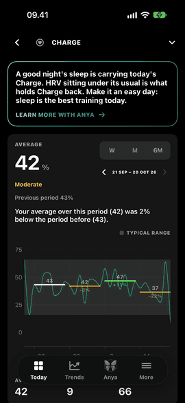

</td>
</tr>
</table>

### Sleep

<table>
<tr>
<td valign="top">

The Sleep screen carries the whole night.

- Sleep performance is made of four parts you can read: **performance** (hours against your need), **efficiency**, **restorative** sleep (deep plus REM) and **consistency** (bedtime regularity).
- **The stage chart** in five styles you pick in Appearance (Classic, Fitbit, Fill, Garmin, Ribbon), with each stage's share and your typical range, the night's sleep time and hours against your usual.
- **Need and debt**: your personal need and the debt you carry, which fades night by night.
- **The night ends where the strap stopped recording**, not where the session happened to close.
- **Edit the sleep or a nap** and undo a delete for ten seconds. The **sleep planner** sets your wake time, the bedtime to aim for and the alarm; **body clock** and **wind down** have their own screens.
- Anya names an evening habit (alcohol, late caffeine, a late meal) as the cause of a poor night **only if your own nights show it**.

</td>
<td width="250" valign="top">

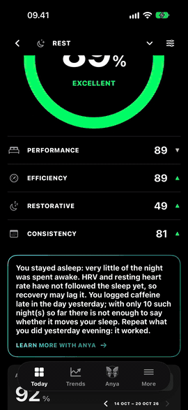

</td>
</tr>
</table>

### Workouts

<table>
<tr>
<td valign="top">

**Start an activity** with a target built for how you train:

- **Pick a sport** from a page with All, Strain, Recovery and Sleep tabs (pin up to eight), see a map of where you are, and choose targets: **time**, **distance** and a **heart-rate zone** are three targets, each on or off by itself.
- The sheet shows your **current Strain**, the **estimate after the activity** and the **Activity strain** itself against the range that suits today, with Anya's suggested session as the default.
- **Activity settings**: zone buzz on the strap, the audio coach, keep the screen on.
- The **live screen** has a Strain tab with a target ring and a Heart rate tab with a zone ring round a disc that beats at your pace, and sport-specific tiles. The strap **buzzes when
  you drift out of your zone**, and a time or distance target is announced once. **End** and **Discard** are WHOOP-style questions, and a running activity can only be left through End.
- It survives the app being away: the workout and its targets are saved as it runs.
- **Live Activity** on the Lock Screen and in the Dynamic Island. The Lock Screen has two designs, **Default** and **Banner** (a card with the clock, the PHMN mark, the heart rate and a bar of the five zones), chosen in Optional features.

</td>
<td width="250" valign="top">

</td>
</tr>
</table>

**Afterwards**

<table>
<tr>
<td valign="top">

- **One log for every sport**, drawn after WHOOP's: when it ran with a heart-rate curve and the zones, the route on a map if one was recorded, key statistics that fit the sport (pace for a run, speed for a ride, time and heart rate for a class) and the Strain it added with your 30-day average. **Tap a zone** and its stretches light up on the curve.
  A session that never reached the first zone gets a low-intensity log that says so.
- **Anya reads the session** against your own last 30 days of the same sport.
- **Treadmill** sessions get a distance estimated from steps and your height, and **Edit activity** lets you correct distance, time and more afterwards.
- **Auto-detect** offers a workout it found (and names a sport only on evidence) as an *Activity detected* row to process, **Add activity** logs one by hand, **History** lists them by week, and **Training load** shows the balance of your last weeks.
- **Strava**: workouts found there with heart rate are offered in Today's activities, and a session can be sent to Strava. Export a session as a FIT file or its route as GPX; a strength session goes up with its sets, calories and heart rate.

</td>
<td width="250" valign="top">

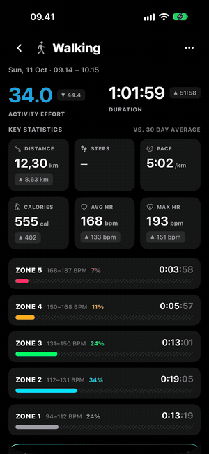

</td>
</tr>
</table>

### Strength Trainer

<table>
<tr>
<td valign="top">

A module of its own, in the style of Hevy, under **More › Application**.

- Three tabs: **Progress** (a volume chart you can touch, personal records, the muscle map), **My Program** (Start, My Workouts, Generate with Anya, build your own) and **Explore** (a photo grid of ready-made workouts to save to a group).
- **Programs** you can group into folders, built from a library of **876 exercises** with photos and the muscles each one works. Import a program from a spreadsheet, or save any finished session as one.
- A **full-screen session** with sets, weight, reps, RPE, a rest timer and a tone when rest ends, and a Live Activity. **The strap advances your sets**: double-tap to move on instead of reaching for the phone.
- **During a session**: preview a program's exercises, replace one (for next time or for this session only), start from any exercise, continue on its own after the rest, add custom exercises, and keep the screen on; a session comes back after the app is closed. **Anya can build a program** from a target and your instructions.
- **Muscle map**: a body map showing which muscles are recovering and which are ready, and sets per muscle.
- **The summary**: Activity strain and the **cardio / muscular split** against your usual sessions, key statistics for lifting (volume, sets, reps, duration, heart rate, calories), an **Exercises** tab where each
  exercise opens to its sets, its record and its demo, and a **Heart rate zones** tab. Personal records are flagged.
- **Demos**: an animation from the two photos of each exercise, and a **video** one tap away in the same place.
- **Hevy** workouts and routines can be imported, read-only.

</td>
<td width="250" valign="top">

</td>
</tr>
</table>

### Trends

<table>
<tr>
<td valign="top">

- **W, M, 6M and 1Y** beside the title, with a date stepper that pages back through your history.
- A **summary** with three rings and what changed against the period before, Anya's read, and **comparisons** of Recovery with Strain and Recovery with Sleep.
- **Daily signals**, a **Recovery heat map**, what moves your Recovery, the change since the previous period, and ways into Explore, Compare and Insights.
- **Export a PDF report**: a readable multi-page summary with charts and a daily data table.

</td>
<td width="250" valign="top">

</td>
</tr>
</table>

### Anya, the coach

Anya reads your **computed scores, not raw data**, and answers in plain language. Tap Anya anywhere and a sheet opens on *that* figure, with a **Read** tab and an **Ask** tab.

<table>
<tr>
<td valign="top">

- **Bring your own provider and key**, run a local model, or use **Apple Intelligence** on the device. With none, Anya still writes her reads from rules on the phone.
- She builds **the day's session** with the Strain it should earn, reads **weather and air** before an outdoor session, writes the **Day In Review**, and keeps **memories** you can edit, pause or delete.
- She says what a figure **means**, names a cause only as far as your numbers go, and gives no verdict without enough history.
- **Log by talking**: tell her what you ate, in words or with a **photo**, and she estimates each item; you can change the name, calories, macros and portion before anything is added. Tell her your lab results, or attach a report (PDF, CSV or FHIR), and they
  come back as a card to check before they go into the Lab Book. On Nutrition she speaks up when the day runs over or short of your target, and she can suggest a **plan** from your own data and the WHO references; nothing changes until you apply it.
- A chart, a program, a workout or a breathing exercise she makes comes back as a **card** you can use, even when a model names the block loosely.

</td>
<td width="250" valign="top">

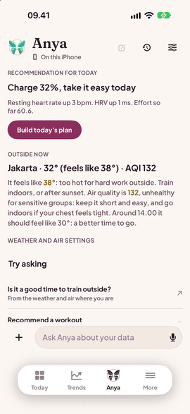

</td>
</tr>
</table>

### Breathing

<table>
<tr>
<td valign="top">

The **Breathing** tab is laid out like the Strength Trainer: **Progress** (minutes by day, touch a bar, sessions as cards that open their report), **Breathe** and **Explore**.

- **Techniques** with a step-by-step page, a photographic background and an aura, grouped by kind of breathing, with **Resonance** and **Calm me** as sessions of their own. Heart a technique to keep it in **My Exercises**.
- **Anya makes custom breathing exercises**, and the audio cue is off, soft tones or Anya's voice; the timer follows the clock, so it stays right with the screen locked.
- A **breathing advisor** that picks a goal (calm, sleep, focus, energise, recover) and one of the templates from your live heart rate, HRV, stress, recovery and the time of day, on the phone, never a forceful technique on its own.
- A session with haptics and a tone, a **scrolling breath line** to follow, and a report; **End** on a paused session asks before it saves. Every session is logged as a recovery activity. **Wind down**, **smart alarm**, **nap detection** and **hydration** keep their own screens.

</td>
<td width="250" valign="top">

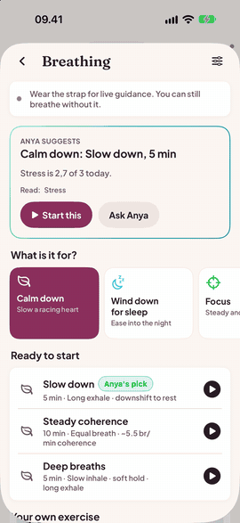

</td>
</tr>
</table>

### Health

<table>
<tr>
<td valign="top">

The **Health** tab holds the slow things.

- **Fitness age**: a weekly **Body age** from nine inputs, each shown as the years it adds or takes away, with the **pace of aging** on a ruler from −1.0× to 3.0× and its own trend pages. Which inputs have data is shown, and an input without data is not guessed.
- **Lab Book**: a ring of your markers by status, every marker as a card with its range from your own report, a page per marker with the readings over time, and one **Add a result** flow to type a result, import a file (a CSV template to fill in, or a FHIR file) or choose the marker. Weight and waist
  use the WHO reference when your report has none.
- **Health monitor**: your vitals (respiration, blood oxygen, resting heart rate, HRV, temperature) against your own range, calibrated over seven nights and settled at fourteen; **Stress monitor**: today's stress in three parts (total, outside activity, asleep) once 14 nights are in.
- **Vital signs**: live heart rate on a timeline of the day, and an **early warning** that watches for a body under strain without saying more than the numbers show.
- **Weight** and body composition (type a measurement or import it), **VO₂ max** (estimated, or typed in), **mood** check-ins, **menstrual cycle** and a rhythm view.
- **Nutrition**: what is left to eat today in a ring, protein, carbs and fat against your targets, and a diary by meal. Add food by typing the numbers, from saved or recent foods, or by telling Anya (text or photo). **Strategy** sets a pace, a daily target and the macros,
  shows the week against the target, and offers a weekly check-in. Import from Cronometer or MacroFactor is in the settings.
- **Achievements**: a level, your data streak, your best and lowest days.

</td>
<td width="250" valign="top">

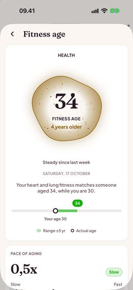

</td>
</tr>
</table>

### Journal and plans

<table>
<tr>
<td valign="top">

- **Journal**: a full-screen page for the last week, with a card for every behavior (yes or no, or a count), follow-up questions, **Smart log with Anya** (write the day in your own words and the behaviors it answers are filled in) and a note for the day.
  **Use previous answers** fills a day's unanswered questions with the day before's; you can change any of them, and turning it off takes back only what it filled in. **Behavior insights** shows what your own days say about each behavior.
- **My Plan**: weekly plans with activities and behaviors, such as **Boost Fitness**, **Feel Better** and **Sleep Deeper**, a **Custom** one you build, and a **GLP-1 Companion** that is built from a few questions. The week's progress and a morning highlight show on Home.

</td>
<td width="250" valign="top">

</td>
</tr>
</table>

### The strap

<table>
<tr>
<td valign="top">

- **Device Settings** has a **Status** tab (the strap, its battery with a charging animation, last sync, and **Broadcast heart rate** to share the heart rate with compatible apps and devices, on a 5.0 / MG) and an **Advanced** tab with the device ID and firmware, **Add a device**, **Reconnect**, **Test vibration**, **Restart strap**
  (5.0 / MG), the **Strap log** to copy or share when reporting a problem, and **Remove** and **Delete data** for the strap. The strap and its tabs stay pinned while the page scrolls.
- A WHOOP-only **add-a-device** wizard (4.0 and 5.0 / MG) with a pairing checklist. Pairing a 5.0 / MG needs the strap freed from the official WHOOP app first; see [docs/IOS.md](docs/IOS.md).
- **Alarms and reminders**: the wake alarm buzzes the strap itself, and a double tap turns a ringing alarm off. A phone notification tells you when the strap has been **off your wrist for ten minutes**, and takes itself back when you put it on or charge it.

</td>
<td width="250" valign="top">

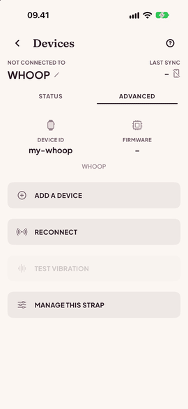

</td>
</tr>
</table>

### Widgets, Live Activities and shortcuts

<table>
<tr>
<td valign="top">

- **Widgets**: Score, Rings, four glance widgets (the three scores in a row, the Sleep ring, the Recovery and Strain rings, and the rings with HRV and Calories), Vital sign, Heart rate, Stress, Anya, Steps and **Steps this week**. Every figure opens its own detail.
- **Live Activities**: workout, lift session and strap sync, on the Lock Screen and in the Dynamic Island.
- **Shortcuts and Siri**: mark a moment, buzz the strap, ask Anya, sync the strap. **Home Screen quick actions** open the main places directly.

</td>
<td width="250" valign="top">

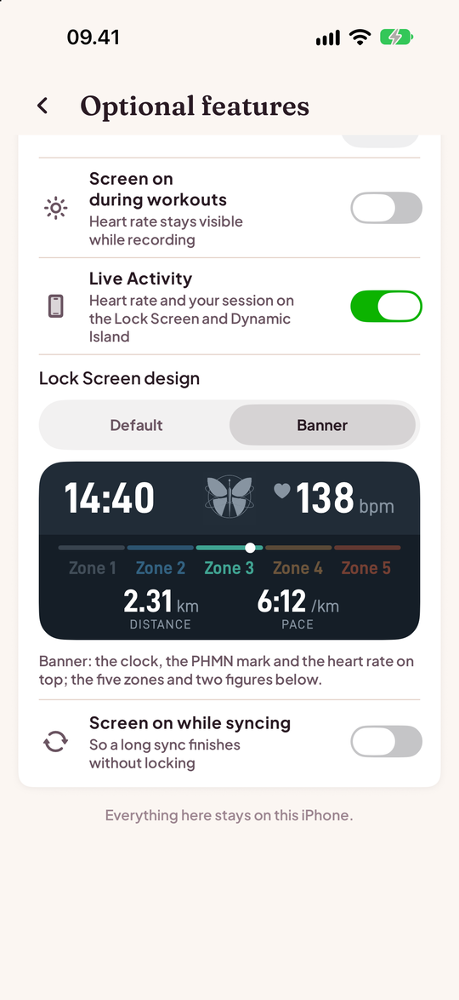

</td>
</tr>
</table>

### Connections

All off by default, all with your own keys, none sends anything until you ask.

| Connection | What it does |
|---|---|
| **Apple Health** | Reads steps, weight, waist and more; writes steps and workouts back. On a sideloaded free-ID build HealthKit is not available, see [docs/SIGNING.md](docs/SIGNING.md) |
| **Strava** | Uploads GPS, treadmill and gym sessions, by hand or automatically. You create a Strava API app and enter its Client ID and Secret, kept in the Keychain. Needs Strava premium |
| **Hevy** | Imports workouts and routines, read-only. The app never writes to Hevy. The Hevy API is part of Hevy Pro |
| **Weather and air** | OpenWeather and IQAir, your own keys. Only your place, rounded to about a kilometre, is sent |
| **An AI provider** | For Anya, only if you choose one |

### Settings

<table>
<tr>
<td valign="top">

The **More** tab is the settings hub, laid out after WHOOP's: **Account and settings** (My Account, Device Settings, App Settings, Privacy Settings), **Support** (How it works, What's new, Feedback, About), a search for the individual setting (type
"live activity" and it opens the right switch) and the app version at the bottom. Choices are drop-downs and every setting is one card.

- **My Account** has your profile and levels, **Achievements**, your **persona** (age and sex; weight and height are read from Apple Health), your **targets** and your **heart-rate zones** with the maximum heart rate.
- **App Settings**
  - *Experience*: switch the whole app between the original NOOP look (**Default**) and **Nuna**, the redesign. Your data, scores and settings stay the same, and the switch reloads the app shell.
  - *Appearance*: three looks (Default, WHP and Flow) with their own typefaces, all set at the same sizes; Flow is a warm cream-and-berry style with rounded shapes, Fraunces figures and Plus Jakarta Sans text, and follows Light, Dark or Automatic, **units** (metric or imperial, and Strain on WHOOP's 0 to 21 or 0 to 100), and the **language**, English or Indonesian, with Anya's reply language set on its own.
  - *Notifications*: Anya's morning brief, the early-illness warning, a summary after a workout, a journal reminder, "Strain target reached", strap battery, and alarms and bedtime.
  - *Strap automations*: **wrist alerts** as one master switch for every vibration, **double tap** and what it does, a Shortcut when the strap goes on or off, **session cues** (breathing, intervals, live session, workout start and end),
    heart-rate zone coaching, a stress check with a minute of guided breathing, a **sitting reminder** inside the hours you choose, a **strap off-body** reminder after ten minutes, and the **Siri and Shortcuts** actions.
  - *Optional features*: water tracker, **auto-detect workouts** (it only suggests, never saves on its own), journal reminder, **screen on during workouts**, Live Activity, screen on while syncing, and cycle awareness (only on this iPhone).
  - *Application*: which of vital signs, stress, sleep, water, lab book, nutrition, nap, Strength Trainer and Trends are shown.
- **Advanced and experiments**: the Strain method, continuous overnight HRV, power saving, **Experiments** (Rhythm, Live Sessions, sleep staging V2, an estimated SpO₂, wake refinement from motion, a personal stress baseline and the **WHOOP 5/MG wake alarm**), and a **Test Centre** for diagnostics.
- **Data and Privacy**: **Data and integrations**, **Backup** and **Privacy**.
- **Support**: **How it works**, **What's new**, **Feedback** (opens a GitHub issue, see below) and **About** with the open-source notices.

</td>
<td width="250" valign="top">

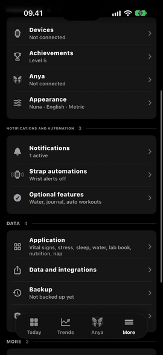

</td>
</tr>
<tr>
<td colspan="2" align="center">

Experience switches the app between the original NOOP look and Nuna; Appearance picks a style (Default, WHP or Flow) and a theme (Light, Dark or Automatic).

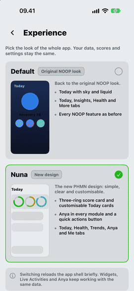
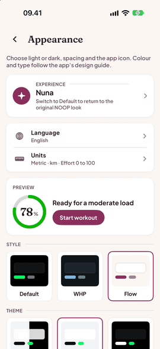

</td>
</tr>
</table>

### Data and privacy

- **Import** WHOOP CSV and Apple Health exports, **back up** and restore to a folder (the backup carries what PHMN keeps outside its database too), **export** a PDF report of your trends, and export a session as FIT or GPX.
- **Privacy** lists exactly what can leave the phone and its live state: a text summary to an AI provider (and the words or photo of a meal you ask Anya to estimate), Strava, Apple Health, weather and air, and your own exports and backups, and nothing else. It also opens iOS Settings for every permission,
  and can delete the Apple Health data PHMN imported without touching the strap's.
- **Feedback** has no service behind it. *Share feedback* and *Report a problem* open a new issue on this repository in your browser, with its outline started for you; you write the rest and send it on GitHub, so you need a GitHub account. The app adds only its version, your iOS version, the model of your iPhone and the language,
  never health data, and makes no contact with GitHub until you tap a button.
- **Updates.** Once a day, after onboarding and the terms, the app reads the version number of the latest release on this repository (nothing about you is sent) and puts a row in the bell when a newer one exists. It cannot install anything: a sideloader does that. Turn the daily check off and it makes no request at all.

---

## How the numbers are made

PHMN adds several calculations on top of NOOP's, and each one is written down with its formula and the file that holds it, in **[docs/CALCULATIONS.md](docs/CALCULATIONS.md)**:

- **Strain** (the code calls it Effort): a logarithm of heart-rate load with Banister's exponential impulse, so Strains do not simply add. The *after activity* estimate, the split of a day between workouts and everyday movement, and the planning estimate for a session.
- **Today's Strain target** from Recovery, and how **Anya's session** is chosen and sized from your own history.
- **Body age** and **pace of aging**: nine inputs, each as years added or taken away, in **[docs/FITNESS_AGE.md](docs/FITNESS_AGE.md)**.
- **Stress**: the 0 to 3 reading from heart rate and heart-rate variability against your baseline.
- **Cardio and muscular split**, **workout reads** against your last 30 days, and the 30-day average pills.
- **Resting heart rate** as the mean of the night's longest session, with its limits stated.
- **Sleep**: where a night ends, how debt builds, and when a habit is named as a cause.
- **Nutrition**: the trend weight, what the body spends, the daily target and macros, the weekly check-in, and the WHO references an Anya plan is shown against. **Lab Book ranges** and where a WHO reference stands in for one.
- **Workout detection**, **training load**, **readiness**, **treadmill distance**, **weather and air advice** and the **breathing advisor**.

---

## Install

Go to the **[latest release](https://github.com/aansun/PHMNoop/releases/latest)** and download the IPA. It is **unsigned** and has no Apple Watch app, so iOS will not run it until it is signed for your device.

- **SideStore or AltStore, with updates**: add this repository's source once, `https://raw.githubusercontent.com/aansun/PHMNoop/phm/altstore-source.json`, and every new release appears there by itself. Nothing outside this repository is used.
- **With a sideloader** (AltStore or SideStore), by hand: open the IPA in the sideloader. It signs it on your phone with your Apple ID and refreshes it for you. Details and troubleshooting are in [docs/IOS.md](docs/IOS.md).
- **Without a sideloader**: sign it yourself on a Mac, with a paid developer account or an enterprise certificate, or build it from source. Step by step in **[docs/SIGNING.md](docs/SIGNING.md)**.

With a free Apple ID, **HealthKit is not available** to a sideloaded build. Build from source with Xcode (below) if you want Apple Health.

Pairing a WHOOP 5.0 / MG needs the strap freed from the official WHOOP app first; see [docs/IOS.md](docs/IOS.md) and [NOOP's README](https://github.com/ryanbr/noop#readme).

**What's new** in each release is in the app under **About › What's new**, which also reads new releases from here by itself, and on the [Releases](https://github.com/aansun/PHMNoop/releases) page, in two groups:
*New / Enhancement* and *Bug Fixing*. How releases are written is in [docs/phmn-releases](docs/phmn-releases).

## Build from source

Needs a Mac with Xcode and [XcodeGen](https://github.com/yonaskolb/XcodeGen).

1. `cp Config/BundleIdSecrets.example.xcconfig Config/BundleIdSecrets.xcconfig`, then set your own `BUNDLE_ID_PREFIX` and `DEVELOPMENT_TEAM`. That file is gitignored.
2. `xcodegen generate`
3. Open `Strand.xcodeproj`, choose the **NOOPiOS** scheme and your iPhone, and run.

To build an IPA yourself, archive without the Watch app, run `Tools/prepare-ios-sideload-app.sh` on the `.app` so the widget keeps its App Group request, and zip it as `Payload/PHMN.app`.

## Status

PHMN is an **iOS app**, built and tested on my own iPhone with my own strap, and iOS is the only thing I work on and support. NOOP's Mac and Android apps are still in the repository because it
carries NOOP's history, but they are not part of PHMN: they are not built, tested or maintained here, and nothing on this page applies to them. The animations are from the iOS simulator with sample data.

## Credit and license

**Gym.** The gym screens stand on other people's work, all of it open:

- **[MuscleMap](https://github.com/melihcolpan/MuscleMap)** by Melih Colpan, MIT licence: the body map.
- **[free-exercise-db](https://github.com/yuhonas/free-exercise-db)** by yuhonas, The Unlicense (public domain): the 876 exercises, their muscles and instructions, and the two photos of each.
- **[openGym](https://github.com/DuarteSantos8/openGym)** by Duarte Santos, GNU AGPL-3.0: the idea of a body map of trained and tired muscles came from it. No openGym code, data, photos or animations are in PHMN; the readings here are written from your logged sets.

The full licence texts are in [THIRD_PARTY_NOTICES.md](THIRD_PARTY_NOTICES.md) and in the app under **More › About and help › Open-source notices**.

**NOOP.** Everything underneath is **NOOP** and its contributors: [github.com/ryanbr/noop](https://github.com/ryanbr/noop). NOOP builds on
[johnmiddleton12/my-whoop](https://github.com/johnmiddleton12/my-whoop) and [b-nnett/goose](https://github.com/b-nnett/goose); see
[ATTRIBUTION.md](ATTRIBUTION.md) and [NOTICE](NOTICE). NOOP's own README is kept as [docs/NOOP_README.md](docs/NOOP_README.md), and the documents
in [`docs/`](docs/) and [CHANGELOG.md](CHANGELOG.md) describe NOOP. Fonts: D-DIN-PRO, Montserrat, Fraunces and Plus Jakarta Sans, under the SIL Open Font License.

PHMN stays under NOOP's license, [PolyForm Noncommercial 1.0.0](LICENSE): free for noncommercial use.

Required Notice: Copyright 2026 NoopApp

PHMN is not affiliated with, endorsed by, or connected to WHOOP, Inc., Strava, Inc., Hevy or the NOOP project. "WHOOP", "Strava" and "Hevy" are used
only to identify the hardware and services the app works with.
