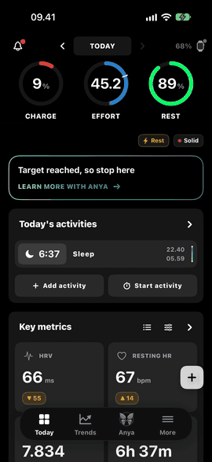
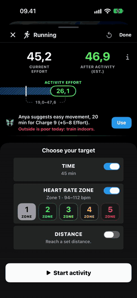
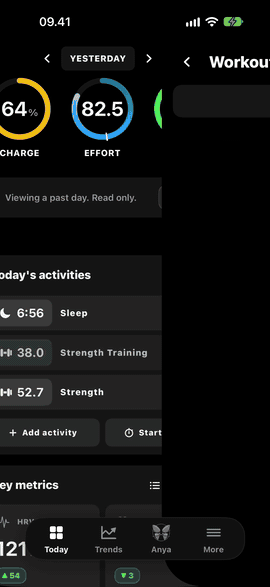
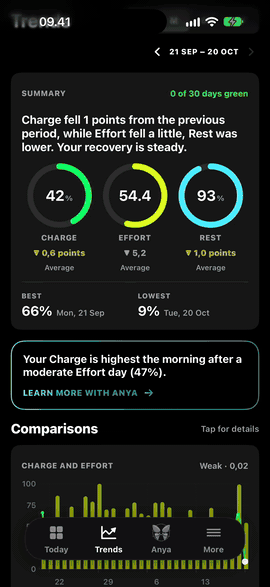
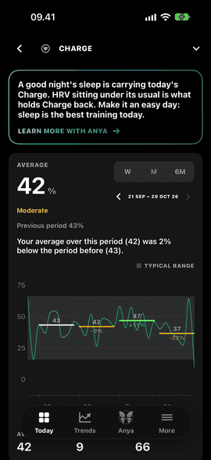
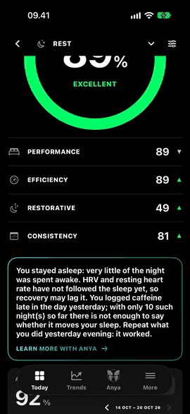
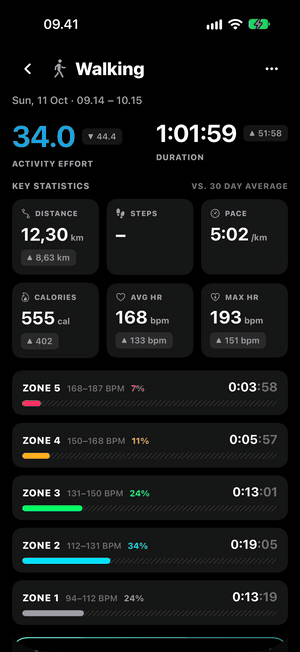
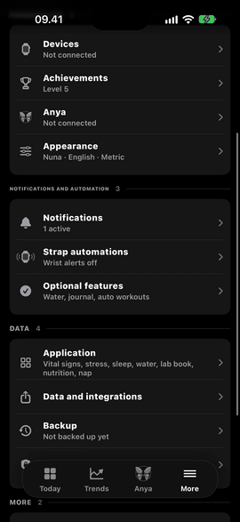

  

<h1 align="center">PHMN</h1>

<b>NOOP, reshaped around my own routine.</b>

A personal project, built for my own needs. Offline, on-device, no account, no cloud.

  
  
  
  

  <a href="#a-personal-project">About</a> ·
  <a href="#the-tour">Feature tour</a> ·
  <a href="#how-the-numbers-are-made">Calculations</a> ·
  <a href="#install">Install</a> ·
  <a href="#build-from-source">Build</a> ·
  <a href="#credit-and-license">Credit</a>

---

## A personal project

PHMN is a fork of [NOOP](https://github.com/ryanbr/noop), the open-source app that reads a WHOOP strap over Bluetooth and keeps every number on your phone. I did not set out to
build a product. I use a WHOOP, I wanted the iPhone app to behave the way **I** check my day, and so I changed it until it did. Everything here follows my own habits and needs; it may
not fit yours, and I make no promise that it will.

The strap protocol, storage, sleep staging and base scores underneath are NOOP's. What I changed is what sits on top: a new design, a coach that reads your day, a workout module with a
gym of its own, and the explanations behind every number.

**What stays true**

- Everything is computed and stored **on the phone**. There is no PHMN server, no account and no telemetry.
- Anything that can leave the phone (Strava, Apple Health, Hevy, weather and air, an AI provider) is **off until you turn it on**, uses **your own** key, and is listed under Privacy.
- Every figure is an **estimate, not medical advice**. Where a number needs history to mean anything, the app says what it is waiting for instead of inventing one.

---

## The tour

The animations are short screen recordings of the app on sample data.

- [Today](#today) · [Metrics](#metrics-charge-effort-rest-and-the-rest) · [Sleep](#sleep) · [Workouts](#workouts) · [Gym](#gym) · [Trends](#trends) · [Anya](#anya-the-coach)
- [Breathing](#breathing-and-recovery) · [Health and body](#health-and-body) · [Strap](#the-strap) · [Widgets and Live Activities](#widgets-live-activities-and-shortcuts)
- [Connections](#connections) · [Settings](#settings) · [Data and privacy](#data-and-privacy)

### Today

  

The home screen is built to be read in a few seconds, then explored.

- **Three rings, pinned.** Charge (how recovered you are), Effort (how much strain the day has taken) and Rest (how well you slept). They shrink into a bar as you scroll. The Effort ring shows
  **today's target range**, worked out from your Charge, as a grey stretch with a white mark where it starts.
- **Two chips that explain themselves.** *Push / Maintain / Rest* is your readiness for training; *Solid / Last night / Calibrating / No data* is the state of your Charge. Tap either to see why
  it says that, what to do, which signals sit behind it and what each dot colour means.
- **Anya's card** follows the day: the morning plan with an Effort target, the session while it runs, what a finished session earned against the target, a rest note once the target is met, a
  journal prompt after 20:00, and the weather and air when you go outside.
- **Today's activities**: the night's sleep and every workout in the order they happened, each opening its own detail, with **Add activity** and **Start activity** under them.
- **Key metrics** as cards or a list, optionally with a trend line per metric, each with its change since yesterday. Choose which ones, in Customize.
- **Stress**, vital signs, your journal strip and a mood check-in, and **quick actions** (the + button) for logging and for every part of the app.
- **Past days** are one swipe away and read-only. **The bell** holds what is new in the app and your data, including the early warning when your body looks strained.
- **Customize** the order and visibility of every card.

### Metrics: Charge, Effort, Rest and the rest

  

Every metric opens **one card** with a **W / M / 6M** switch and a date stepper, the same on all of them: Charge, Effort, Rest, HRV, resting heart rate, blood oxygen, respiratory rate, skin temperature,
steps, calories, weight, stress and more.

- A ring or hero figure with a level word, the parts it is made of with their change against the night before, Anya's line about what the figure *means* (not the figure again), the trend chart and
  the average, lowest and highest.
- **How it's calculated** and **What affects it** sit at the foot as quiet notes, so a number is never a black box.
- Charge is coloured green from 67, yellow from 34, red below; Effort dark blue to light blue by how hard the day was. The same colours are used on the widgets.

### Sleep

  

The Rest screen carries the whole night.

- Rest is made of four parts you can read: **performance** (hours against your need), **efficiency**, **restorative** sleep (deep plus REM) and **consistency** (bedtime regularity).
- **The stage chart** in five styles you pick in Settings (Classic, Fitbit, Fill, Garmin, Ribbon), the night's sleep time and hours against your usual, naps, wake-ups, vitals through the night.
- **Need and debt**: your personal need and the debt you carry, which fades night by night.
- **The night ends where the strap stopped recording**, not where the session happened to close.
- **Edit the sleep or a nap** and undo a delete for ten seconds. **Body clock**, **smart alarm** and **wind down** have their own screens.
- Anya names an evening habit (alcohol, late caffeine, a late meal) as the cause of a poor night **only if your own nights show it**.

### Workouts

  

**Start an activity** with a target built for how you train:

- **Pick a sport** (pin up to eight), see a map of where you are, and choose targets: **time**, **distance** and a **heart-rate zone** are three targets, each on or off by itself.
- The sheet shows your **current Effort**, the **estimate after the activity** and the **Activity effort** itself against the range that suits today, with Anya's suggested session as the default.
- **Activity settings**: zone buzz on the strap, the audio coach, keep the screen on.
- The **live screen** has an Effort tab with a target ring and a Heart rate tab with a disc that beats at your pace in the colour of your zone, a zone bar, and sport-specific tiles. The strap **buzzes when
  you drift out of your zone**, and a time or distance target is announced once.
- It survives the app being away: the workout and its targets are saved as it runs.
- **Live Activity** on the Lock Screen and in the Dynamic Island.

**Afterwards**

  

- **One layout for every sport**: when it ran and the Effort it added with your 30-day average, the map if a route was recorded, key statistics that fit the sport (pace for a run, speed for a ride,
  time and heart rate for a class), the heart-rate curve and the zones. **Tap a zone** and its stretches light up on the curve.
- **Anya reads the session** against your own last 30 days of the same sport.
- **Review it**: slide to say how it felt, add photos. They stay on the phone.
- **Treadmill** sessions get a distance estimated from steps and your height, and **Edit activity** lets you correct distance, time and more afterwards.
- **Auto-detect** offers a workout it found (and names a sport only on evidence), **Add activity** logs one by hand, **History** lists them by week, and **Training load** shows the balance of your last weeks.
- Export a session as a FIT file or its route as GPX, or send it to Strava.

### Gym

  

A module of its own, in the style of Hevy.

- **Programs** you can group into folders, built from a library of **876 exercises** with photos and the muscles each one works. Import a program from a spreadsheet, or save any finished session as one.
- A **full-screen session** with sets, weight, reps, RPE, a rest timer and a tone when rest ends, and a Live Activity.
- **The strap advances your sets**: double-tap to move on instead of reaching for the phone.
- **Muscle map**: a body map showing which muscles are recovering and which are ready, and sets per muscle.
- **The summary**: Activity Effort and the **cardio / muscular split** against your usual sessions, key statistics for lifting (volume, sets, reps, duration, heart rate, calories), an **Exercises** tab where each
  exercise opens to its sets, its record and its demo, and a **Heart rate zones** tab. Personal records are flagged.
- **Hevy** workouts and routines can be imported, read-only.

### Trends

  

- **W, M, 6M and 1Y** beside the title, with a date stepper that pages back through your history.
- A **summary** with three rings and what changed against the period before, Anya's read, and **comparisons** of Charge with Effort and Charge with Rest.
- **Daily signals**, a **Charge heat map**, what moves your Charge, the change since the previous period, and ways into Explore, Compare and Insights.
- **Export a PDF report**: a readable multi-page summary with charts and a daily data table.

### Anya, the coach

Anya reads your **computed scores, not raw data**, and answers in plain language. Tap an Anya card anywhere and a sheet opens on *that* figure, with a **Read** tab and an **Ask** tab.

- **Bring your own provider and key**, run a local model, or use **Apple Intelligence** on the device. With none, Anya still writes her reads from rules on the phone.
- She builds **the day's session** with the Effort it should earn, reads **weather and air** before an outdoor session, writes a **daily brief**, and keeps **memories** you can edit, pause or delete.
- She says what a figure **means**, names a cause only as far as your numbers go, and gives no verdict without enough history.

### Breathing and recovery

- A **breathing advisor** that picks a goal (calm, sleep, focus, energise, recover) and one of 15 templates from your live heart rate, HRV, stress, recovery and the time of day, on the phone, never a forceful technique on its own.
- A session with haptics and a tone, and a report. **Wind down** for the evening, **smart alarm**, **nap detection**, and **hydration** with a quick-log amount you set.

### Health and body

- **Vital signs**: live heart rate on a timeline of the day, and your vitals against your own range. **Early warning** watches for a body under strain, without saying more than the numbers show.
- **Fitness age** and its **pace of aging**, **weight** and body composition, **nutrition**, **mood** check-ins, **menstrual cycle**, a **lab book** and a rhythm view.
- **Achievements**: a level, your data streak, your best and lowest days.

### The strap

- A WHOOP-only **add-a-device** wizard (4.0 and 5.0 / MG) with a pairing checklist, and a **Status / Advanced** screen showing the link, battery and last sync.
- Pairing a 5.0 / MG needs the strap freed from the official WHOOP app first; see [docs/IOS.md](docs/IOS.md).

### Widgets, Live Activities and shortcuts

- **Widgets**: Score, Rings, Vital sign, Heart rate, Stress, Anya, Steps and **Steps this week**. Every figure opens its own detail.
- **Live Activities**: workout, lift session and strap sync, on the Lock Screen and in the Dynamic Island.
- **Shortcuts and Siri**: mark a moment, buzz the strap, ask Anya, sync the strap. **Home Screen quick actions** open the main places directly.

### Connections

All off by default, all with your own keys, none sends anything until you ask.

| Connection | What it does |
|---|---|
| **Apple Health** | Reads steps, weight, waist and more; writes steps and workouts back. On a sideloaded free-ID build HealthKit is not available, see [docs/SIGNING.md](docs/SIGNING.md) |
| **Strava** | Uploads GPS, treadmill and gym sessions, by hand or automatically. You create a Strava API app and enter its Client ID and Secret, kept in the Keychain. Needs Strava premium |
| **Hevy** | Imports workouts and routines, read-only. The app never writes to Hevy. The Hevy API is part of Hevy Pro |
| **Weather and air** | OpenWeather and IQAir, your own keys. Only your place, rounded to about a kilometre, is sent |
| **An AI provider** | For Anya, only if you choose one |

### Settings

  

The **More** tab is the settings hub: grouped, with a profile on top, and every row says its current value instead of a generic description. **Search** reaches the individual setting: type
"live activity" and it opens the right switch, and the ones you opened last are listed.

- **Personalize**: **Devices** (the strap, its battery and last sync), **Achievements**, **Anya** (provider, key, memory and the morning brief) and **Appearance**.
  - *Appearance*: two looks (Default and WHP) with their own typography, **units** (metric or imperial, and Effort on 0 to 100 or WHOOP's 0 to 21), and the **language**, English or Indonesian, with Anya's reply language set on its own.
  - Your **persona** (age, height, weight, maximum heart rate), your **heart-rate zones** and your **targets**.
- **Notifications and automation**
  - *Notifications*: Anya's morning brief, the early-illness warning, a summary after a workout, a journal reminder, "Effort target reached", strap battery, and alarms and bedtime.
  - *Strap automations*: **wrist alerts** as one master switch for every vibration, **double tap** and what it does, a Shortcut when the strap goes on or off, **session cues** (breathing, intervals, live session, workout start and end),
    heart-rate zone coaching, a stress check with a minute of guided breathing, a **sitting reminder** inside the hours you choose, and the **Siri and Shortcuts** actions.
  - *Optional features*: water tracker, **auto-detect workouts** (it only suggests, never saves on its own), journal reminder, **screen on during workouts**, Live Activity, screen on while syncing, and cycle awareness (only on this iPhone).
- **Data**: **Application** (which of vital signs, stress, sleep, water, lab book, nutrition and nap are shown), **Data and integrations**, **Backup** and **Privacy**.
- **More**: **Advanced and experiments**, a **Test Centre** for diagnostics, **Open-source notices**, **What's new** and help.

### Data and privacy

- **Import** WHOOP CSV and Apple Health exports, **back up** and restore to a folder, **export** a PDF report of your trends, and export a session as FIT or GPX.
- **Privacy** lists exactly what can leave the phone and its live state: a text summary to an AI provider, Strava, Apple Health, weather and air, and your own exports and backups, and nothing else. It also opens iOS Settings for every permission,
  and can delete the Apple Health data PHMN imported without touching the strap's.

---

## How the numbers are made

PHMN adds several calculations on top of NOOP's, and each one is written down with its formula and the file that holds it, in **[docs/CALCULATIONS.md](docs/CALCULATIONS.md)**:

- **Effort**: a logarithm of heart-rate load, so Efforts do not simply add. The *after activity* estimate, the split of a day between workouts and everyday movement, and the planning estimate for a session.
- **Today's Effort target** from Charge, and how **Anya's session** is chosen and sized from your own history.
- **Cardio and muscular split**, **workout reads** against your last 30 days, and the 30-day average pills.
- **Resting heart rate** as the mean of the night's longest session, with its limits stated.
- **Sleep**: where a night ends, how debt builds, and when a habit is named as a cause.
- **Training load**, **readiness**, **treadmill distance**, **pace of aging**, **weather and air advice** and the **breathing advisor**.

---

## Install

Go to the **[latest release](https://github.com/aansun/PHMNoop/releases/latest)** and download the IPA. It is **unsigned** and has no Apple Watch app, so iOS will not run it until it is signed for your device.

- **With a sideloader** (AltStore or SideStore): open the IPA in the sideloader. It signs it on your phone with your Apple ID and refreshes it for you. Details and troubleshooting are in [docs/IOS.md](docs/IOS.md).
- **Without a sideloader**: sign it yourself on a Mac, with a paid developer account or an enterprise certificate, or build it from source. Step by step in **[docs/SIGNING.md](docs/SIGNING.md)**.

With a free Apple ID, **HealthKit is not available** to a sideloaded build. Build from source with Xcode (below) if you want Apple Health.

Pairing a WHOOP 5.0 / MG needs the strap freed from the official WHOOP app first; see [docs/IOS.md](docs/IOS.md) and [NOOP's README](https://github.com/ryanbr/noop#readme).

**What's new** in each release is in the app under **About › What's new**, which also reads new releases from here by itself, and on the [Releases](https://github.com/aansun/PHMNoop/releases) page, in two groups:
*New / Enhancement* and *Bug Fixing*. How releases are written is in [docs/phmn-releases](docs/phmn-releases).

## Build from source

Needs a Mac with Xcode and [XcodeGen](https://github.com/yonaskolb/XcodeGen).

1. `cp Config/BundleIdSecrets.example.xcconfig Config/BundleIdSecrets.xcconfig`, then set your own `BUNDLE_ID_PREFIX` and `DEVELOPMENT_TEAM`. That file is gitignored.
2. `xcodegen generate`
3. Open `Strand.xcodeproj`, choose the **NOOPiOS** scheme and your iPhone, and run.

To build an IPA yourself, archive without the Watch app, run `Tools/prepare-ios-sideload-app.sh` on the `.app` so the widget keeps its App Group request, and zip it as `Payload/PHMN.app`.
Design notes for Nuna, the design language, are in [docs/nuna](docs/nuna).

## Status

PHMN is an **iOS app**, built and tested on my own iPhone with my own strap, and iOS is the only thing I work on and support. NOOP's Mac and Android apps are still in the repository because the fork
carries NOOP's history, but they are not part of PHMN: they are not built, tested or maintained here, and nothing on this page applies to them. The animations are from the iOS simulator with sample data.

## Credit and license

**Gym.** The gym screens stand on other people's work, all of it open:

- **[MuscleMap](https://github.com/melihcolpan/MuscleMap)** by Melih Colpan, MIT licence: the body map.
- **[free-exercise-db](https://github.com/yuhonas/free-exercise-db)** by yuhonas, The Unlicense (public domain): the 876 exercises, their muscles and instructions, and the two photos of each.
- **[openGym](https://github.com/DuarteSantos8/openGym)** by Duarte Santos, GNU AGPL-3.0: the idea of a body map of trained and tired muscles came from it. No openGym code, data, photos or animations are in PHMN; the readings here are written from your logged sets.

The full licence texts are in [THIRD_PARTY_NOTICES.md](THIRD_PARTY_NOTICES.md) and in the app under **More › About and help › Open-source notices**.

**NOOP.** Everything underneath is **NOOP** and its contributors: [github.com/ryanbr/noop](https://github.com/ryanbr/noop). NOOP builds on
[johnmiddleton12/my-whoop](https://github.com/johnmiddleton12/my-whoop) and [b-nnett/goose](https://github.com/b-nnett/goose); see
[ATTRIBUTION.md](ATTRIBUTION.md) and [NOTICE](NOTICE). NOOP's own README is kept as [docs/NOOP_README.md](docs/NOOP_README.md), and the documents
in [`docs/`](docs/) and [CHANGELOG.md](CHANGELOG.md) describe NOOP. Fonts: D-DIN-PRO and Montserrat, under the SIL Open Font License.

PHMN stays under NOOP's license, [PolyForm Noncommercial 1.0.0](LICENSE): free for noncommercial use.

Required Notice: Copyright 2026 NoopApp

PHMN is not affiliated with, endorsed by, or connected to WHOOP, Inc., Strava, Inc., Hevy or the NOOP project. "WHOOP", "Strava" and "Hevy" are used
only to identify the hardware and services the app works with.
