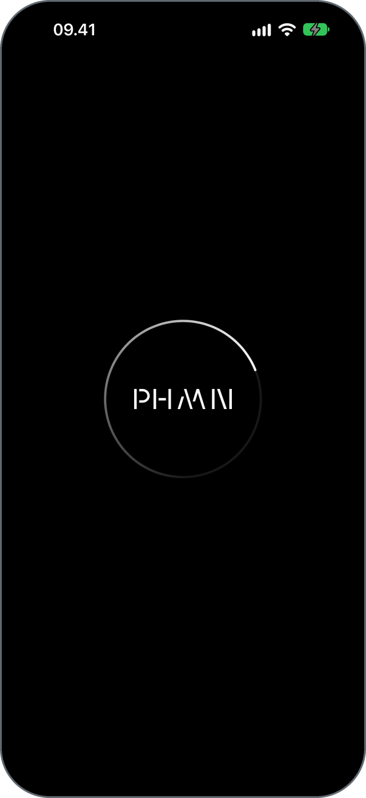
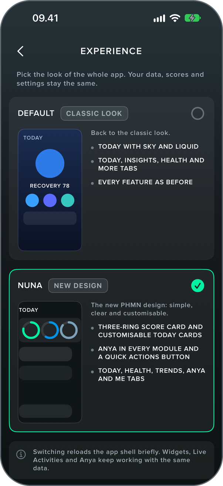

<p align="center">
  
</p>

<h1 align="center">PHMN</h1>

<p align="center"><b>NOOP, reshaped around my own routine.</b></p>

<p align="center"><sub>A personal project, built for my own needs. Offline, on-device, no account, no cloud.<br>I focus on iOS only. NOOP's Mac and Android apps are not maintained here.</sub></p>

<p align="center">
  
  
</p>

<p align="center">
  <a href="#a-personal-project">About</a> ·
  <a href="#things-to-know-before-you-use-it">Before you use it</a> ·
  <a href="#the-tour">Feature tour</a> ·
  <a href="#how-the-numbers-are-made">Calculations</a> ·
  <a href="#install">Install</a> ·
  <a href="#build-from-source">Build</a> ·
  <a href="#credit-and-license">Credit</a>
</p>

---

## A personal project

PHMN is a fork of [NOOP](https://github.com/ryanbr/noop), the open-source app that reads a WHOOP strap over Bluetooth and keeps every number on your phone. I did not set out to
build a product. I use a WHOOP, I wanted the iPhone app to behave the way **I** check my day, and so I changed it until it did. Everything here follows my own habits and needs; it may
not fit yours, and I make no promise that it will.

The strap protocol, storage and base scores underneath are NOOP's. What I changed is what sits on top: a new design, a coach that reads your day, a Health tab, a workout module with a
Strength Trainer of its own, weekly plans, and the explanations behind every number. A few calculations differ too, and they are listed under [Things to know before you use it](#things-to-know-before-you-use-it).

> **A note on where it stands.** The interface and its experience are designed with care, and the way the app is used is meant to stay. The accuracy of the data keeps being worked on.
> That will take a long while, because it needs real data collected over a long period, for as long as I wear this strap.

**What stays true**

- Everything is computed and stored **on the phone**. There is no PHMN server, no account and no telemetry.
- Anything that can leave the phone (Strava, Apple Health, Hevy, weather and air, an AI provider) is **off until you turn it on**, uses **your own** key, and is listed under Privacy.
- Every figure is an **estimate, not medical advice**. Where a number needs history to mean anything, the app says what it is waiting for instead of inventing one.

---

## Things to know before you use it

PHMN differs from NOOP in these places on purpose. Please read them before you rely on the numbers.

| | What is different |
|---|---|
| **Score names** | **Recovery**, **Strain** and **Sleep** (NOOP: Charge, Effort, Rest). Strain uses a 0 to 21 scale; 0 to 100 is one switch away |
| **Body age** | Replaces NOOP's fitness age and Vitality score: a weekly age from nine inputs, see [FITNESS_AGE.md](docs/FITNESS_AGE.md). Earlier weeks are worked out again on first open |
| **Strain** | Counts effort at every intensity and takes off the cost of being awake, so light work shows. The zone-based score is a switch under Advanced |
| **Stress** | A 0 to 3 reading from heart rate and its variability against your own baseline, shown after 14 nights |
| **Sleep** | A wake of up to 3 minutes can count as light sleep, a night ends where the strap stopped recording, and off-wrist time is cut out. Scores can differ from NOOP's |
| **Resting heart rate** | An average, not the night's lowest, so Recovery can differ too |
| **Steps** | On a WHOOP 5, today's total is rebuilt from the strap's counter. Apple Health receives only new steps, so none count twice |
| **Workout detection** | Offered only after 2 minutes in the first heart-rate zone or higher. It never saves by itself, and a deleted one stays deleted |
| **WHOOP 5.0 / MG alarm** | Needs the **wake alarm** switch under Experiments and is not confirmed on every strap. **Keep a backup alarm** |
| **Strava** | Upload by hand at first, to check what is sent |

---

## The tour

What PHMN adds on top of NOOP. Everything NOOP already does is still there and is described in [NOOP's README](docs/NOOP_README.md).

| | Key points |
|---|---|
| **Home** | Recovery, Strain and Sleep rings with today's Strain target, Health and Stress monitors, **My Day**, highlights, your plan and your own dashboard |
| **Sleep** | The night in four parts, need and debt, a **sleep planner** with a weekly alarm schedule and an experimental early wake, body clock and **Beat rhythm** |
| **Workouts** | Time, distance and zone targets, a live screen with strap buzz outside your zone, Lock Screen Live Activity, treadmill distance and a summary read against your last 30 days |
| **Strength Trainer** | Programs, 876 exercises with demos, a full-screen session the strap can advance, muscle map and records |
| **Health** | **Body age** and pace of aging, **blood pressure**, Lab Book, **Nutrition**, weight, VO₂ max and mood |
| **Anya** | A coach that converses, looks up your own data to answer, explains the figure you tap, plans the day, and logs a meal, a lab result or a workout from your words. She keeps what you tell her **about you**, learns the food figures you correct, and can check in if you ask her to. Your own AI provider, Apple Intelligence, or none |
| **Breathing** | Guided sessions with a countdown and voice or tones, exercises Anya writes, and an advisor that picks one for the moment |
| **Plans and journal** | Weekly plans with activities and behaviours, and a journal Anya can fill from your own words |
| **Look and language** | The new design or the original NOOP look, three styles, widgets, English and Indonesian |

### Connections

All off by default, with your own keys: **Apple Health** (steps, weight, blood pressure and more; not on a free-ID sideload), **Strava** upload (needs Strava premium), **Hevy** import (read-only), **weather and air** (OpenWeather, IQAir) and an **AI provider** for Anya.

### Data and privacy

- Everything is computed and stored on your phone. **Privacy** lists exactly what can leave it, and its live state.
- With the Anthropic provider and data access on, Anya looks things up on the phone to answer you; what she looks up goes to the provider. The journal, blood pressure and lab results are included only if you also share patterns and Lab Book.
- Back up and restore to a folder, import WHOOP CSV and Apple Health exports, export a PDF report, FIT or GPX.
- **Updates:** once a day the app reads the number of the latest release here, sending nothing about you; you can turn it off.
- **Feedback** opens a GitHub issue in your browser, and the **Ko-fi** button opens the support page. Neither is contacted until you tap.

---

## How the numbers are made

PHMN adds several calculations on top of NOOP's, and each one is written down with its formula and the file that holds it, in **[docs/CALCULATIONS.md](docs/CALCULATIONS.md)**:

- **Strain** (the code calls it Effort): a logarithm of heart-rate load with Banister's exponential impulse, so Strains do not simply add. The *after activity* estimate, the split of a day between workouts and everyday movement, and the planning estimate for a session.
- **Today's Strain target** from Recovery, and how **Anya's session** is chosen and sized from your own history.
- **Body age** and **pace of aging**: nine inputs, each as years added or taken away, in **[docs/FITNESS_AGE.md](docs/FITNESS_AGE.md)**.
- **Stress**: the 0 to 3 reading from heart rate and heart-rate variability against your baseline.
- **Cardio and muscular split**, **workout reads** against your last 30 days, and the 30-day average pills.
- **Resting heart rate** as the mean of the night's longest session, with its limits stated.
- **Sleep**: where a night ends, how debt builds, and when a habit is named as a cause.
- **Nutrition**: the trend weight, what the body spends, the daily target and macros, the plan Anya explains, the food figures it learns from you, the weekly check-in, and the WHO references a plan is shown against. **Lab Book ranges** and where a WHO reference stands in for one.
- **Blood pressure** beside your other data, and the **early wake** decision.
- **Workout detection**, **training load**, **readiness**, **treadmill distance**, **weather and air advice** and the **breathing advisor**.

---

## Install

**With SideStore or AltStore (updates arrive by themselves)**, add this source once:

```
https://raw.githubusercontent.com/aansun/PHMNoop/phm/altstore-source.json
```

**Or by hand:** download the IPA from the [latest release](https://github.com/aansun/PHMNoop/releases/latest) and open it in your sideloader.

Good to know:

- The IPA is **unsigned** and has no Apple Watch app. To sign it yourself, see [docs/SIGNING.md](docs/SIGNING.md).
- With a free Apple ID, **Apple Health is not available**. [Build from source](#build-from-source) if you need it.
- A WHOOP 5.0 / MG has to be freed from the official WHOOP app before pairing, see [docs/IOS.md](docs/IOS.md).

What is new in each release is in the app under **More › What's new** and on the [Releases](https://github.com/aansun/PHMNoop/releases) page.

## Build from source

Needs a Mac with Xcode and [XcodeGen](https://github.com/yonaskolb/XcodeGen).

1. `cp Config/BundleIdSecrets.example.xcconfig Config/BundleIdSecrets.xcconfig`, then set your own `BUNDLE_ID_PREFIX` and `DEVELOPMENT_TEAM`. That file is gitignored.
2. `xcodegen generate`
3. Open `Strand.xcodeproj`, choose the **NOOPiOS** scheme and your iPhone, and run.

To build an IPA yourself, archive without the Watch app, run `Tools/prepare-ios-sideload-app.sh` on the `.app` so the widget keeps its App Group request, and zip it as `Payload/PHMN.app`.

## Credit and license

PHMN is a fork of **[NOOP](https://github.com/ryanbr/noop)**: everything underneath is the work of NOOP and its contributors. NOOP builds on
[my-whoop](https://github.com/johnmiddleton12/my-whoop) and [goose](https://github.com/b-nnett/goose), see [ATTRIBUTION.md](ATTRIBUTION.md) and [NOTICE](NOTICE).

**Also used**

| Project | Used for | License |
|---|---|---|
| [MuscleMap](https://github.com/melihcolpan/MuscleMap) by Melih Colpan | The body map | MIT |
| [free-exercise-db](https://github.com/yuhonas/free-exercise-db) by yuhonas | The 876 exercises, their instructions and photos | The Unlicense |
| D-DIN-PRO, Montserrat, Fraunces, Plus Jakarta Sans | Fonts | SIL Open Font License |

Full license texts are in [THIRD_PARTY_NOTICES.md](THIRD_PARTY_NOTICES.md) and in the app under **More › About › Open source licenses**.

**License**

PHMN keeps NOOP's license, [PolyForm Noncommercial 1.0.0](LICENSE): free for noncommercial use.

Required Notice: Copyright 2026 NoopApp

<sub>PHMN is not affiliated with, endorsed by, or connected to WHOOP, Inc., Strava, Inc., Hevy or the NOOP project. "WHOOP", "Strava" and "Hevy" are used only to identify the hardware and
services the app works with. NOOP's own documents are kept in <a href="docs/">docs</a> and <a href="CHANGELOG.md">CHANGELOG.md</a>.</sub>
